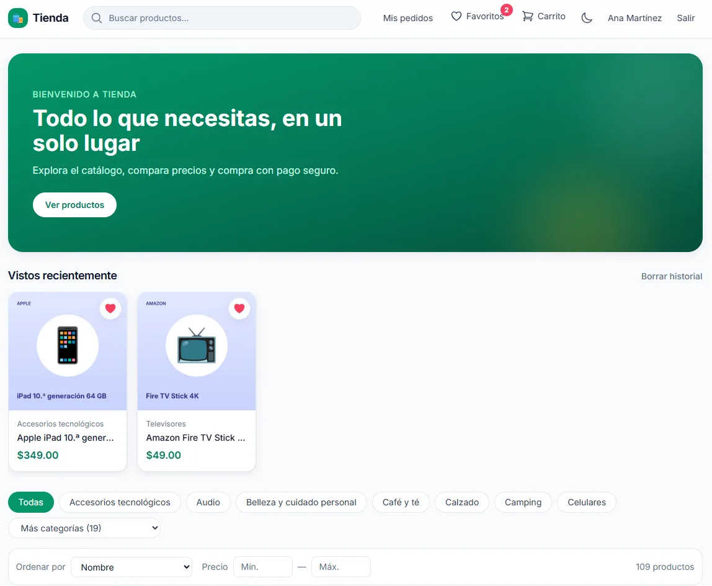
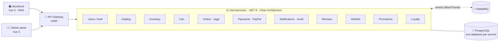

<div align="center">

# 🛒 E-commerce Microservices

**A complete online store built as 11 .NET 8 microservices, with a Vue 3 storefront, an admin panel and event-driven integration over RabbitMQ.**

[](https://github.com/DarielAngel/ecommerce-microservicios/actions/workflows/ci.yml)


<sub>📘 Detailed step-by-step build guide (Spanish): <a href="docs/GUIA-CONSTRUCCION.md">docs/GUIA-CONSTRUCCION.md</a></sub>



</div>

## ✨ Features

| For shoppers (storefront) | For the owner (admin panel) |
|---|---|
| Catalog with search-as-you-type, filters, variants and "you may also like" | Products, variants, images, categories and stock |
| Cart, address book and one-step checkout with **PayPal** | Orders with status timeline (Paid → Shipped) |
| Order tracking, "buy again" and estimated delivery | Approve/refund/reject **returns** with notes |
| **Returns & partial refunds** within 30 days | **Coupons**: percentage/fixed, validity, min. purchase, usage limits |
| **Coupons**, **loyalty points** (earn & redeem) | Review moderation |
| **Reviews** with "verified purchase" and **wishlist** | Protected by JWT roles + site key |
| Installable **PWA** with offline catalog and update prompt | |
| Dark mode, mobile-first design, transactional emails | |

## 🏗️ Architecture



**Ground rules applied across the whole system**

1. **One bounded context = one microservice**, each with its own PostgreSQL database and `Domain → Application → Infrastructure → Api` projects (Clean Architecture + CQRS with MediatR + FluentValidation).
2. **Synchronous HTTP only when an answer is needed right now** (e.g. checking stock); everything else propagates as **RabbitMQ events** via MassTransit. Contracts live in `src/Shared/Contracts` and are only ever extended, never broken.
3. **Everything goes through the Gateway** (YARP): the browser knows a single URL.
4. **Security**: shared JWT with refresh tokens; roles are enforced in every service, not just in the UI.
5. **Consistency**: the checkout is an **Order–Inventory–Payment saga**; refunds are idempotent and can never return more than was charged — not by rounding, retries or two admins at once.

## 🧪 Quality

| Layer | Tooling | Runs in CI |
|---|---|---|
| Unit tests (Domain + Application) | xUnit · FluentAssertions · NSubstitute | ✅ 11 projects |
| Integration tests (real Postgres & RabbitMQ) | Testcontainers · WebApplicationFactory | ✅ 11 projects |
| Frontend unit tests | Vitest · Vue Test Utils | ✅ storefront + admin |
| End-to-end (full stack in Docker) | Playwright | ✅ checkout, coupons, points, returns, reviews, wishlist, PWA |

The CI pipeline fails loudly if it ever finds fewer than 22 test projects, so a renamed project can't make the build go green without testing anything.

## 🚀 Quick start

**Requirements:** Docker Desktop (Compose v2). The .NET 8 SDK and pnpm are only needed for local development.

```bash
git clone https://github.com/DarielAngel/ecommerce-microservicios.git
cd ecommerce-microservicios
cp .env.example .env          # set PAYPAL_PROVIDER=Fake to test checkout without a PayPal account
docker compose up -d --build  # 11 services + 11 databases + RabbitMQ + gateway + 2 frontends
```

| App | URL |
|---|---|
| 🛍️ Storefront | http://localhost:5173 |
| 🧑‍💼 Admin panel | http://localhost:8081 |
| 🚪 API Gateway | http://localhost:5000 (`/health`) |
| 🐇 RabbitMQ UI | http://localhost:15672 |

### Run the tests

```bash
# Backend: every service has *.UnitTests and *.IntegrationTests (Docker required for the latter)
dotnet test src/Services/Orders/Orders.Tests/Orders.UnitTests/Orders.UnitTests.csproj

# Frontend
cd storefront && pnpm install && pnpm test:unit

# End-to-end against the running stack
cd e2e && pnpm install && pnpm exec playwright test
```

## 🗂️ Repository layout

```
src/
├── Gateway/              YARP reverse proxy (single entry point)
├── Services/             Users · Catalog · Inventory · Cart · Orders · Payments ·
│                         Notifications · Reviews · Wishlist · Promotions · Loyalty
└── Shared/Contracts/     integration events shared over RabbitMQ
storefront/               Vue 3 + Pinia + Tailwind shopper app (PWA)
admin-panel/              Vue 3 + Tailwind back office
e2e/                      Playwright end-to-end suite
docs/                     build guide, local testing guide, market analysis and roadmap
```

## 🗺️ Roadmap

Built in phases, each one closed with tests before starting the next. All phases of the current cycle are done — see [docs/ROADMAP-FUNCIONALIDADES.md](docs/ROADMAP-FUNCIONALIDADES.md) and the [market analysis](docs/ANALISIS-MERCADO.md) behind it.

- [x] Core: infrastructure, users/auth, catalog, inventory, cart, payments, orders saga, notifications, admin panel, storefront
- [x] Visual identity & design system · reviews · wishlist · coupons · discovery
- [x] Fast checkout & tracking · loyalty & abandoned-cart emails · returns & refunds · PWA
- [ ] Next: multi-currency & i18n · AI shopping assistant · subscriptions · multi-vendor

## 👤 Author

**Dariel Angel Arro Moreno** — Full-stack developer (.NET · Vue · Django)
[Portfolio](https://darielangel.github.io) · [GitHub](https://github.com/DarielAngel) · [darielarrom@gmail.com](mailto:darielarrom@gmail.com)
